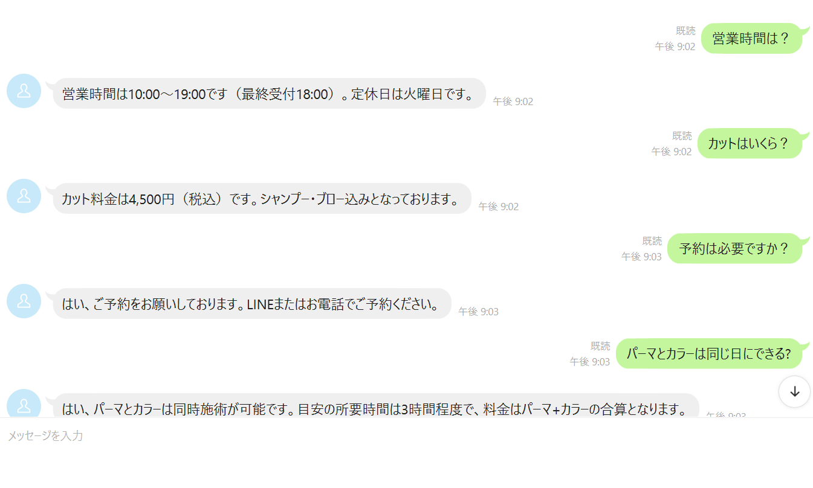
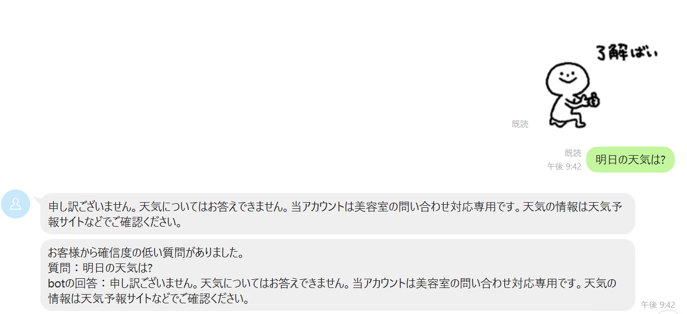
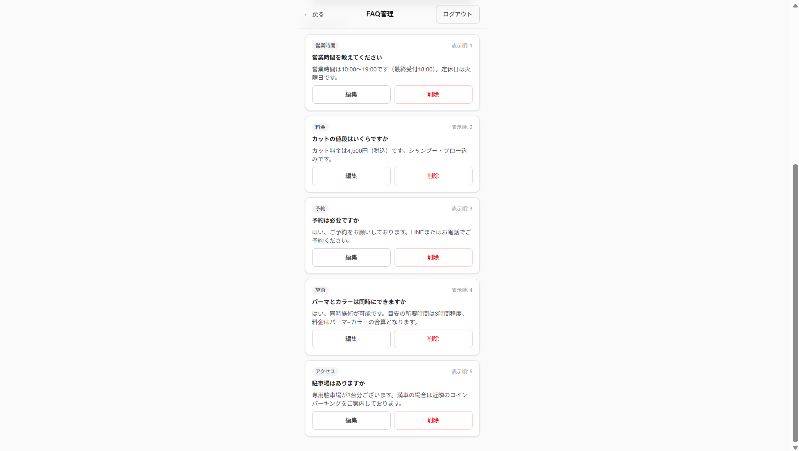
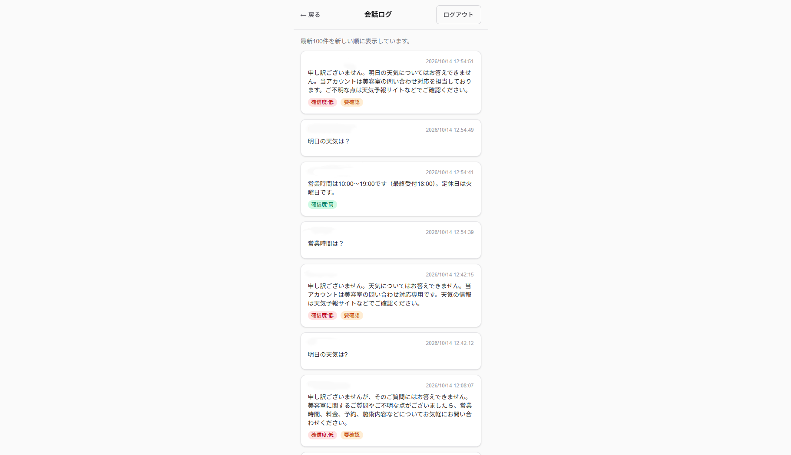
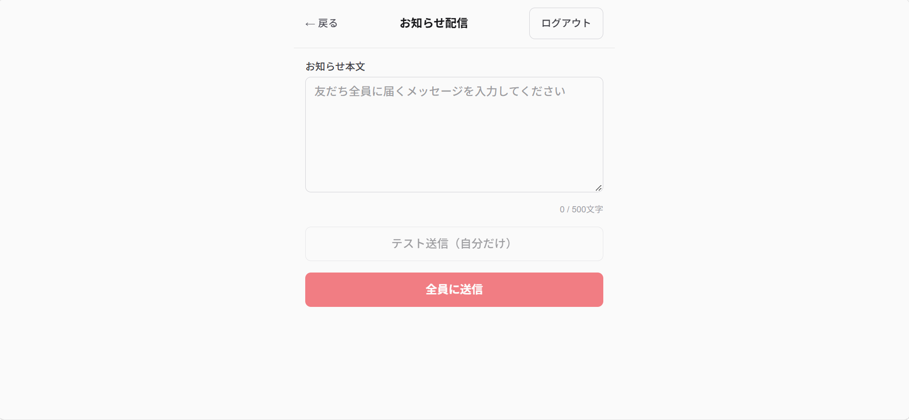
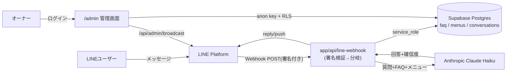

# line-bot-app

> **これは美容室オーナー向け「LINE bot + AI自動応答」を想定した模擬案件(練習用プロジェクト)です。**
> 実在のクライアント案件ではなく、実務を想定して一人で設計・実装したポートフォリオ用リポジトリです。

公開URL: https://line-bot-app-psi.vercel.app
(管理画面は `/admin` 配下にあり、ログインしたオーナー(管理者登録済みアカウント)のみ利用できます)

---

## 1. プロジェクト概要

美容室では、営業時間やメニュー・料金といった同じ質問に、オーナーが都度LINEで手入力で返信する負担があります。
本プロジェクトは、LINE公式アカウントに届いた質問をAI(Claude)がFAQ・メニュー情報をもとに自動応答し、
AIが自信を持てない質問だけをオーナーに通知(エスカレーション)する仕組みです。
FAQ・メニューの登録や会話ログの確認は、スマートフォンからでも操作しやすい管理画面(`/admin`)で行います。

## 2. 主な機能

- **FAQ自動応答**: LINEに届いたテキストメッセージを、登録済みのFAQ・メニュー情報だけを根拠情報としてClaudeに渡し、日本語で回答を生成します。
- **信頼度判定とエスカレーション通知**: Claudeは回答と同時に確信度(`high`/`mid`/`low`)を返し、`low`の場合はオーナーのLINEにpush通知で質問内容と回答案を知らせます。
- **管理画面(`/admin`)**: FAQ・メニューの登録/編集/削除、会話ログの閲覧(確信度・要確認バッジ付き)。スマホでの片手操作を想定し、タップ領域は44px以上を確保しています。
- **お知らせ一斉配信**: 管理画面からLINE公式アカウントの友だち全員、またはオーナー自身へのテスト送信ができます。
- **テキスト以外のメッセージの扱い**: スタンプは無応答(ログにも残さない)、画像・動画・音声・ファイル・位置情報は「テキストでご質問をお送りください」という案内を返信し、種類だけ(`[画像]`など)を会話ログに記録します。Claudeは呼び出しません。
- **FAQ取得失敗時の安全網**: Supabaseからのデータ取得に失敗した場合は、誤った回答をしないようClaudeを呼ばずに「担当者に確認してお答えします」と返信し、オーナーに「FAQ取得エラー」をpush通知します。正当な0件(未登録)の場合とは、サーバーログの文言で区別しています。

## 3. 画面・動作イメージ

スクリーンショットは `docs/images/` 配下に以下のファイル名で配置する想定です(未配置の場合は下の画像は表示されません)。

| 場所 | 内容 |
|---|---|
| `docs/images/line-faq-reply.png` | LINEでFAQに答える様子 |
| `docs/images/line-escalation.png` | 「担当者に確認します」+オーナー通知 |
| `docs/images/admin-faq.png` | 管理画面(FAQ編集) |
| `docs/images/admin-conversations.png` | 会話ログ(要確認バッジ) |
| `docs/images/admin-broadcast.png` | お知らせ配信画面 |







## 4. 技術構成

| 技術 | 用途・選定理由 |
|---|---|
| [Next.js](https://nextjs.org/) 16 (App Router) | Route Handler(`app/api/line-webhook/route.ts`)でWebhook受信、管理画面もServer Component中心に同一リポジトリ・同一デプロイで完結できるため |
| TypeScript | LINE/Supabase/ClaudeそれぞれのSDK型定義を活かし、イベント種別の分岐などを型チェックで保護するため |
| Tailwind CSS v4 | `tailwind.config.*`無しのCSS-first構成。管理画面のUIを一人で素早く組むため |
| [Supabase](https://supabase.com/)(Postgres + Auth + RLS) | DBとオーナーログイン認証をまとめて持て、Row Level Securityでテーブルごとのアクセス制御ができるため |
| [@line/bot-sdk](https://www.npmjs.com/package/@line/bot-sdk) | LINE公式SDK。Webhook署名検証(`validateSignature`)やMessaging API呼び出しに使用 |
| [@anthropic-ai/sdk](https://www.npmjs.com/package/@anthropic-ai/sdk)(Claude Haiku) | FAQ・メニューのテキストから自然な日本語回答と確信度をJSONで生成させるため |
| [Vercel](https://vercel.com/) | Next.jsアプリのホスティング・デプロイ先 |



## 5. データベース設計

| テーブル | 役割 |
|---|---|
| `faq` | FAQ(カテゴリ・質問・回答・表示順) |
| `menus` | メニュー名・料金・説明・表示順 |
| `conversations` | LINEとの会話ログ(方向、本文、確信度、要確認フラグ) |
| `bot_admins` | 管理画面を操作できる`auth.users`の許可リスト |

このSupabaseプロジェクトは、テーブルを作成しただけでは `anon`/`authenticated`/`service_role` のいずれにも
SELECT等の権限が付かない設定(デフォルト権限に依存しない構成)になっているため、
**RLSポリシーを用意するだけでなく、ロールごとに `grant`/`revoke` を明示する必要があります**。

> **用語の補足(初めての方向け)**
> - **RLS(Row Level Security)**: テーブルの行ごとに「誰がどの行を読み書きできるか」をDB側で制限する仕組みです。例えば「ログイン済みの管理者だけがFAQを編集できる」という制限をアプリのコードではなくDB自体に持たせられます。
> - **GRANT**: RLSとは別に、PostgreSQLがロール(`anon`/`authenticated`/`service_role`など)ごとに「このテーブルへのSELECT/INSERT等を許可する」と宣言する仕組みです。RLSで行を絞る前に、そもそもテーブルへのアクセス自体がGRANTで許可されている必要があります。
> - **service_role**: Supabaseが提供する、RLSを無視して(バイパスして)すべての行にアクセスできる特権キーです。Webhookのようにユーザーのログインを経由しないサーバー処理で使い、ブラウザには絶対に渡しません。
> - **エスカレーション**: AIが自信を持てない質問や、システムの不具合でAIを呼べなかった質問を、自動応答だけで終わらせずに人(オーナー)へ引き上げて確認してもらうことです。

マイグレーション(`supabase/migrations/`)の要点:

- `0001_linebot_init.sql`: `faq`/`menus`/`conversations`を作成。RLSを有効化し、`auth.role() = 'authenticated'`を条件とするポリシーと、`authenticated`ロールへの`grant`を設定(Stage1〜2)。
- `0002_seed_faq.sql`: 初期FAQ5件を投入するシードデータ(Stage2)。
- `0003_bot_admins.sql`: `bot_admins`テーブルと`is_bot_admin()`(`security definer`固定検索パス)を追加し、`faq`/`menus`/`conversations`のRLSポリシーを「ログイン済みなら誰でも」から「`bot_admins`登録者のみ」に差し替え(Stage3)。
- `0004_grant_service_role.sql`: Webhookが使う`service_role`に、`faq`/`menus`へのSELECT、`conversations`へのINSERTのみを付与。RLSとは別にテーブル権限(`GRANT`)が必要なこの構成で、サーバー側の取得処理が機能するために必要な最小権限を追加したもの。

## 6. セキュリティ上の工夫

- **Webhook署名検証**: `app/api/line-webhook/route.ts`は、`@line/bot-sdk`の`validateSignature`でリクエスト本文と`x-line-signature`ヘッダーを検証し、不正または欠落時はイベントを一切処理せず`400`を返します。
- **管理者の許可リスト(`bot_admins`)**: 誰でもログインできても、`bot_admins`に登録されたユーザーのみが`is_bot_admin()`経由でFAQ・メニュー・会話ログにアクセスできます。
- **サーバー側での再検証**: `/admin`配下はNext.jsのproxy(`proxy.ts`)でログインの有無のみをチェックしますが、それはページ遷移の保護に過ぎないため、`app/api/admin/broadcast/route.ts`のような特権API自体にも、ログイン状態と`is_bot_admin()`の両方をサーバー側で再検証する処理を入れています。
- **秘密情報を環境変数に分離**: LINEのチャネルシークレット・アクセストークン、Claude APIキー、Supabaseのservice role keyなどはすべて`process.env`経由で読み込み、コードに直書きしていません。
- **`service_role`をサーバー専用に限定**: `lib/supabase/service.ts`のRLSをバイパスするクライアントはRoute Handler(サーバー)からのみ使用し、ブラウザ/SSR用の`anon`キークライアント(`lib/supabase/client.ts`、`lib/supabase/server.ts`)とはっきり分離しています。

## 7. ローカルでの動かし方

```bash
git clone <このリポジトリのURL>
cd line-bot-app
npm install
```

`.env.local` を作成し、以下の変数名を設定してください(値はこのREADMEに書きません)。

| 変数名 | 用途 |
|---|---|
| `NEXT_PUBLIC_SUPABASE_URL` | SupabaseプロジェクトのURL |
| `NEXT_PUBLIC_SUPABASE_ANON_KEY` | ブラウザ/SSR用の公開キー(RLS前提でアクセス) |
| `SUPABASE_SERVICE_ROLE_KEY` | サーバー専用のRLSバイパスキー(Webhookからの FAQ/メニュー取得・会話ログ記録に使用) |
| `LINE_CHANNEL_SECRET` | LINE Webhookの署名検証用 |
| `LINE_CHANNEL_ACCESS_TOKEN` | LINE Messaging APIへの返信・配信用 |
| `ANTHROPIC_API_KEY` | Claude API呼び出し用 |
| `OWNER_LINE_USER_ID` | エスカレーション通知・テスト配信の送信先(オーナーのLINEユーザーID) |

```bash
npm run dev
```

`http://localhost:3000` で起動します。DBスキーマは`supabase/migrations/`配下のSQLを、Supabase CLIまたはダッシュボードのSQL Editorで番号順(0001→0004)に適用してください。
LINEから実際にメッセージを送って動作確認する場合は、ngrok等でローカルサーバーを公開し、LINE Developers ConsoleのWebhook URLをそのURLに変更する必要があります(要確認: このリポジトリにngrok設定ファイルは含まれていません)。

## 8. デプロイ

本番はVercelにデプロイしています(公開URL: https://line-bot-app-psi.vercel.app)。

- Vercelダッシュボードの環境変数(上記表の変数名)を設定してください。**環境変数を追加・変更した場合は、次のデプロイ(Redeploy)まで反映されません。**
- LINE Developers ConsoleのMessaging API設定で、Webhook URLを `https://line-bot-app-psi.vercel.app/api/line-webhook` にし、「Webhookの利用」をオンにしてください。応答モードは「Bot」にしており、この設定で実際にLINEからメッセージを送って動作確認済みです。
- あいさつメッセージなど、LINE公式アカウント側の他の自動応答機能は、本Botの返信と二重に送信されないよう**オフにしておくことを推奨**します。
- Messaging APIの利用量上限や、チャネル単位の他の設定項目まで網羅的に見直したかどうかは**要確認**です。

## 9. 運用上の注意

- 本アプリのLINE公式アカウントは、**コミュニケーションプラン(月額0円・無料メッセージ200通/月)**で運用しています。
  参考: ライトプラン(5,000円/月・5,000通)、スタンダードプラン(15,000円/月・30,000通)という上位プランもあります。
- 個別の自動応答(reply)は無料メッセージ通数とは別枠ですが、お知らせ一斉配信(`broadcast`)は**送信対象の友だち人数分がまとめて通数としてカウントされる**ため、友だちが多いほど消費が大きくなります。コミュニケーションプランの200通/月は、一斉配信を数回行うだけで消費し切ってしまう規模です。
- `broadcast`は取り消せないため、管理画面では送信前に確認ダイアログを表示し、まず「テスト送信(自分だけ)」で内容を確認してから「全員に送信」する運用を想定しています。

## 10. 動作確認した項目

自動テストは未導入のため、以下はすべて本番環境(Vercel)で実際にLINEおよび管理画面を操作して手動で確認したものです。

- FAQ 5問への回答(言い換えた質問を含む)
- エスカレーション通知(確信度`low`のときにオーナーへpush通知が届くこと)
- FAQ・メニューに記載のない無関係な質問への応答
- スタンプを送った場合に無応答であること
- 画像を送った場合に案内文を返信すること
- お知らせ配信のテスト送信(自分宛)と全員送信

## 11. 今後の拡張(案)

- 予約機能(日時選択・カレンダー連携)
- 画像・スタンプへの簡単な定型応答(現状は「テキストでお送りください」という案内のみ)
- FAQのカテゴリ別検索・キーワード検索
- 複数店舗・複数オーナーでの利用(現状は単一オーナー・単一LINE公式アカウント想定)
- 自動テスト(現状、テストランナーは未導入)

---

本READMEはコードを実際に読んで作成していますが、リポジトリのコードだけでは確認できない事項は「要確認」と明記しています。
