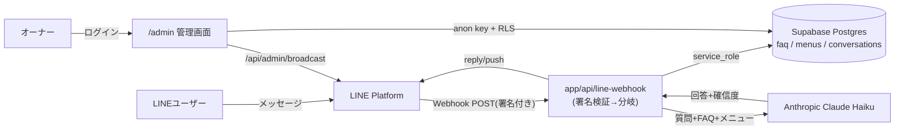

# 技術ドキュメント(下書き)

このプロジェクト(`line-bot-app`)を引き継ぐ開発者向けの技術ドキュメントです。
コードと `supabase/migrations/` を実際に読んで確認できた内容を記載し、未確認の点は **【要確認】** と明記しています。

セットアップ手順(環境変数名、ローカル起動、デプロイ)は [`docs/setup-guide.md`](./setup-guide.md) を、
プロジェクト概要・機能一覧・スクリーンショットは [`README.md`](../README.md) を参照してください。本ドキュメントではそれらと重複する内容は繰り返しません。

---

## 1. 全体構成

(`README.md` の図と同一構成です。本ドキュメントでは以降、各矢印の内部処理を詳述します。)

---

## 2. Webhookの処理の流れ

`app/api/line-webhook/route.ts` の `POST` ハンドラが処理する流れです。

1. **署名検証**: リクエストボディ(生テキスト)と `x-line-signature` ヘッダーを `@line/bot-sdk` の `validateSignature` で検証します。署名が無い、または不正な場合は、イベントを一切処理せず `400` を返します。
2. **ボディのJSONパース**: 署名検証後にボディをJSONとしてパースします。パースに失敗した場合は `400` を返します。
3. **イベントごとのループ**: `callbackRequest.events` を走査し、`type !== "message"` のイベント(フォロー/アンフォロー等)はスキップします。
4. **メッセージ種別による分岐**(`handleMessageEvent`)
   - `replyToken` が無いイベントは処理を中断します。
   - メッセージタイプが `sticker` の場合は**無応答**で、会話ログにも記録しません。
   - メッセージタイプが `text` 以外(`image`/`video`/`audio`/`file`/`location`)の場合は、ユーザー発言を種類表記(`[画像]` など)として会話ログに記録し、「テキストでご質問をお送りください」という案内文を返信します。Claudeは呼び出しません。
   - メッセージタイプが `text` の場合のみ、以降の本処理に進みます。
5. **ユーザー発言の記録**: テキストメッセージを受け取った時点で、`conversations` テーブルに `direction: "user"` として記録します(`userId` が取得できる場合のみ)。
6. **FAQ・メニュー取得**: `createServiceClient()`(service_roleクライアント)で `faq`(`category, question, answer`)と `menus`(`name, price, description`)を並行取得します。
   - 取得に失敗した場合(クエリエラー)は、Claudeを呼ばずに固定文「申し訳ございません、担当者に確認してお答えします」を返信し、`confidence: "low"`・`escalated: true` として会話ログに記録し、オーナーに「FAQ取得エラー」のpush通知を送ります。
   - 取得は成功したが0件の場合は、サーバーログに「FAQは0件です」等を出力するのみで、エラー扱いにはしません(そのままClaudeに空のFAQ/メニュー一覧を渡します)。
7. **Claude呼び出し**: `generateAnswer(receivedText, faqList, menuList)`(`lib/claude.ts`)でFAQ・メニューを根拠情報として渡し、回答文と確信度(`high`/`mid`/`low`)を取得します。詳細は6章を参照。
8. **LINEへの返信**: `lineClient.replyMessage` で回答を返信します。返信自体が失敗した場合は、エラーをログに出して処理を終了します(会話ログへの記録やエスカレーション判定は行われません)。
9. **エスカレーション判定**: `confidence === "low"` の場合を `escalated` とします。
10. **bot発言の記録**: 返信が成功した場合、`conversations` に `direction: "bot"` として回答・確信度・`escalated` フラグを記録します。
11. **オーナー通知**: `escalated` が `true` の場合、オーナーのLINE(`OWNER_LINE_USER_ID`)に質問内容と回答案をpush通知します。`OWNER_LINE_USER_ID` が未設定の場合は通知処理自体が何もせず終了します(`pushToOwner` 内でガード)。

Webhook全体としては、個々のイベント処理を `try/catch` で囲んでおり、1件のイベント処理が例外で落ちても、他のイベントの処理やレスポンス自体(`200 ok`)には影響しません。

---

## 3. API一覧

このプロジェクトのサーバー側APIエンドポイントは、確認できた範囲では以下の2つのみです。管理画面のFAQ/メニュー/会話ログのCRUDは、専用のAPI route ではなく、ブラウザから `@supabase/ssr` 経由でSupabaseへ直接アクセスしています(4・5章を参照)。

| エンドポイント | 認証 | リクエスト概要 | レスポンス概要 |
|---|---|---|---|
| `POST /api/line-webhook` | LINEの署名検証(`x-line-signature` + `validateSignature`)。ユーザーのログインは不要 | LINE Platformからのコールバックペイロード(`webhook.CallbackRequest`、複数イベントを含む) | 署名不正・パース不正時は `400`。それ以外は常に `200`(本文 `"ok"`)。個々のイベント処理の成否はレスポンスには反映されない |
| `POST /api/admin/broadcast` | Supabaseログイン必須 + サーバー側で `is_bot_admin()` をRPC呼び出しして再検証 | JSON `{ mode: "test" \| "all", text: string }`(`text` は1〜500文字) | 成功時 `{ message: "送信しました。" }`。バリデーションエラーは `400`、未ログインは `401`、管理者権限なしは `403`、LINE送信失敗は `502` |

`/api/admin/broadcast` の `mode: "test"` はオーナー自身(`OWNER_LINE_USER_ID`)へのpush送信、`mode: "all"` は友だち全員への `broadcast` 送信です。`OWNER_LINE_USER_ID` が未設定の場合、`mode: "test"` は `500` を返します。

---

## 4. データベース設計

### テーブルと主なカラム

| テーブル | 主なカラム | 役割 |
|---|---|---|
| `faq` | `id`(uuid, PK)、`category`(text, null可)、`question`(text, not null)、`answer`(text, not null)、`sort_order`(int, default 0)、`created_at`、`updated_at` | FAQの質問・回答 |
| `menus` | `id`(uuid, PK)、`name`(text, not null)、`price`(integer, default 0)、`description`(text, null可)、`sort_order`(int, default 0)、`created_at`、`updated_at` | メニュー名・料金・説明 |
| `conversations` | `id`(uuid, PK)、`line_user_id`(text, not null)、`direction`(text, `'user'`\|`'bot'` のみ)、`message_text`(text, not null)、`confidence`(text, `'high'`\|`'mid'`\|`'low'`\|null)、`escalated`(boolean, default false)、`created_at` | LINEとの会話ログ。`line_user_id` にインデックスあり(`idx_conversations_line_user_id`) |
| `bot_admins` | `user_id`(uuid, PK、`auth.users(id)` へのFK、`on delete cascade`)、`created_at` | 管理画面を操作できる`auth.users`の許可リスト |

### RLSポリシー(`0003_bot_admins.sql` 適用後の最終状態)

| テーブル | ポリシー | 内容 |
|---|---|---|
| `faq` | `faq_select_admin` / `faq_insert_admin` / `faq_update_admin` / `faq_delete_admin` | すべて `is_bot_admin()` が `true` の場合のみ許可 |
| `menus` | `menus_select_admin` / `menus_insert_admin` / `menus_update_admin` / `menus_delete_admin` | すべて `is_bot_admin()` が `true` の場合のみ許可 |
| `conversations` | `conversations_select_admin` | SELECTのみ、`is_bot_admin()` が `true` の場合のみ許可 |
| `bot_admins` | `bot_admins_select_self` | `auth.uid() = user_id` の場合のみ、自分の行をSELECT可能 |

いずれのテーブルも `alter table ... enable row level security` によりRLSが有効化されています(`0001_linebot_init.sql`、`0003_bot_admins.sql`)。

### GRANT(ロールへのテーブル権限)

このSupabaseプロジェクトは、テーブル作成だけではロールに権限が自動付与されない設定になっているため、RLSとは別にGRANTが明示的に必要です(`README.md` 5章で確認済み)。

| ロール | テーブル | 権限 | 付与したマイグレーション |
|---|---|---|---|
| `authenticated` | `faq` | SELECT / INSERT / UPDATE / DELETE | `0001_linebot_init.sql` |
| `authenticated` | `menus` | SELECT / INSERT / UPDATE / DELETE | `0001_linebot_init.sql` |
| `authenticated` | `conversations` | SELECT | `0001_linebot_init.sql` |
| `authenticated` | `bot_admins` | SELECT | `0003_bot_admins.sql` |
| `service_role` | `faq` | SELECT | `0004_grant_service_role.sql` |
| `service_role` | `menus` | SELECT | `0004_grant_service_role.sql` |
| `service_role` | `conversations` | INSERT | `0004_grant_service_role.sql` |

`service_role` は上記3件のGRANT以外のテーブル・スキーマへの権限は変更されていません(`0004_grant_service_role.sql` のコメントで確認済み)。

---

## 5. 認証と権限の設計

- **ログイン**: 管理画面(`/admin`)はSupabase Authのメール/パスワード認証です。`app/admin/login/LoginForm.tsx` が `supabase.auth.signInWithPassword` を呼び出し、成功後 `/admin` へ遷移します。
- **ページ遷移のガード(`lib/supabase/proxy.ts`)**: `/admin` 配下は、未ログインなら `/admin/login` にリダイレクトします。ただし、ここでチェックしているのは**ログインの有無のみ**で、`is_bot_admin()` の判定は行いません(コメントで明記)。
- **管理者権限チェック(`app/admin/(protected)/layout.tsx`)**: ログイン済みであっても、`supabase.rpc("is_bot_admin")` が `false` を返すユーザーには「このアカウントには管理画面の権限がありません」という画面を表示し、以降のページ内容(FAQ編集等)を表示しません。
- **`is_bot_admin()` 関数**(`0003_bot_admins.sql`): `security definer` + `set search_path = public` + `stable` で定義されたSQL関数で、`bot_admins` テーブルに `auth.uid()` の行が存在するかを返します。RLSポリシー内・RPC呼び出しの両方から安全に使える設計です。
- **特権API側の再検証(`app/api/admin/broadcast/route.ts`)**: `/admin` ページのガードはページ遷移のみを保護するため、`broadcast` のような特権APIは、ルートハンドラ自身の中で `supabase.auth.getUser()` によるログインチェックと `supabase.rpc("is_bot_admin")` による権限チェックを**再度**行っています。
- **`service_role` の使い分け**(`lib/supabase/service.ts`): RLSを完全にバイパスする特権キーで、LINE Webhook(`app/api/line-webhook/route.ts`)のようにユーザーログインを経由しないサーバー処理でのみ使用します。ブラウザ向けの `anon` キークライアント(`lib/supabase/client.ts`、`lib/supabase/server.ts`)とはファイル・用途ともに明確に分離されています。

---

## 6. Claudeへのプロンプト設計(`lib/claude.ts`)

- **使用モデル**: `claude-haiku-4-5`。
- **根拠情報として渡すもの**: `buildSystemPrompt` が、取得済みの `faqList`(カテゴリ・質問・回答)と `menuList`(名前・価格・説明)をテキスト化してシステムプロンプトに埋め込みます。ユーザーの質問は `messages` の `user` ロールとしてそのまま渡します。
- **確信度(`confidence`)の判定基準**: プロンプト内で以下の3段階をモデル自身に判定させています。
  - `high`: FAQまたはメニュー・料金一覧に直接該当する記述がある場合。
  - `mid`: FAQ・メニューから推測すれば答えられるが完全には一致しない場合。
  - `low`: FAQ・メニューに該当する記述が無い場合、質問が関係ない場合、または判断がつかない場合。
  - あわせて「自己判断で新しい情報を作らないこと」「わからない場合は正直に `low` にする」という指示を入れています。
- **出力形式**: `{"answer": "回答文", "confidence": "high" | "mid" | "low"}` というJSON以外のテキストを一切含めないよう指示しています。
- **JSONが壊れた場合のフォールバック**: レスポンスからテキストブロックを取得できない場合、`extractJsonText`(最初の `{` と最後の `}` の間を抜き出す処理)を通してもJSONパースに失敗した場合、または `answer`/`confidence` の型が期待と異なる場合は、いずれも固定の `FALLBACK_RESULT`(`"申し訳ございません、担当者に確認してお答えします"` / `confidence: "low"`)を返します。Claude API呼び出し自体が例外を投げた場合も同じ `FALLBACK_RESULT` を返します。
- **【要確認】** 確信度の自己採点が実際にどの程度正確か(モデルが過大評価する傾向がないか)は、本ドキュメント作成時点でのコードレビューの範囲では確認できていません。`CLAUDE.md` には、確信度を自己採点させるプロンプトでは下限側に具体的な判定基準を与えるべきという方針が書かれており、本プロンプトの `low` 条件はこの方針に沿っています。

---

## 7. エラー時の挙動の一覧表

| 状況 | お客様への返信 | オーナー通知 | 会話ログへの記録 |
|---|---|---|---|
| 署名不正・欠落(Webhook) | なし(`400`を返すのみ、イベント自体を処理しない) | なし | なし |
| リクエストボディのJSONパース失敗 | なし(`400`) | なし | なし |
| FAQ・メニューの取得失敗(Supabaseクエリエラー) | 固定文「申し訳ございません、担当者に確認してお答えします」 | 「FAQ取得エラー」通知(質問内容付き) | ユーザー発言は記録済み。bot発言も `confidence: "low"` / `escalated: true` で記録 |
| FAQ・メニューが0件(正常系、未登録) | Claudeの判断に従う(根拠情報が空のため、通常は`low`寄りの回答になりやすいと考えられるが、ロジック上は保証されていない) | `confidence`が`low`になった場合のみ通知 | 通常のフローとして記録 |
| Claudeの応答がJSON以外・パース失敗・型不一致・API呼び出し例外 | フォールバック文「申し訳ございません、担当者に確認してお答えします」(`confidence: "low"`扱い) | `confidence`が`low`のため通知される | bot発言として `confidence: "low"` / `escalated: true` で記録 |
| LINEへの返信(`replyMessage`)自体が失敗 | 送信できない(エラーのみログ出力) | 通知されない(この時点で処理が終了するため) | bot発言は記録されない(返信成功後に記録する実装のため) |
| オーナーへのpush通知(`pushMessage`)自体が失敗 | 影響なし(お客様への返信は通知より前に完了済み) | 送信されない(`pushToOwner`内でエラーをログ出力するのみ) | 影響なし(通知は会話ログ記録とは独立した処理) |
| `conversations` へのDB書き込み失敗(insert error) | 影響なし(返信処理より後に行われるため) | 影響なし | 記録されない(エラーをログ出力するのみで、処理は継続) |
| `/api/admin/broadcast` でのLINE送信失敗 | (エンドユーザー向けではなく管理画面向け)管理画面に「LINEへの送信に失敗しました。時間をおいて再度お試しください。」を`502`で返す | — | このAPI自体は会話ログに記録しない |

すべてのケースで、個々のAPI呼び出し・イベント処理は `try/catch` で囲まれており、1箇所のエラーが他の処理やWebhook全体のレスポンスを止めない設計です(`CLAUDE.md` のエラーハンドリング方針に合致)。

---

## 8. 運用上の制約

- **LINEのメッセージ数**: 本アプリのLINE公式アカウントは「コミュニケーションプラン」(月額0円・無料メッセージ200通/月)で運用しています。個別の自動応答(`reply`)は無料通数とは別枠ですが、お知らせ一斉配信(`broadcast`)は**送信時点の友だち人数分がまとめて通数としてカウント**されるため、友だちが多いほど消費が大きくなります(`README.md` 9章で確認済み)。
- **Vercelの無料枠で注意する点**: **【要確認】** 本プロジェクトが実際にVercelのどのプラン(Hobby/Pro等)で運用されているか、関数の実行時間・リクエスト数等の上限に対してどの程度余裕があるかは、本ドキュメント作成時点でVercelダッシュボードを直接確認していません。
- **Supabaseの無料枠で注意する点**: **【要確認】** 同様に、Supabaseプロジェクトのプラン、DB容量・API呼び出し数の上限に対する余裕も未確認です。`conversations` テーブルは会話が発生するたびに行が増え続ける設計のため、長期運用した場合の容量については要注意と考えられますが、具体的な上限や現在の使用量は未確認です。

---

## 9. 既知の制約と今後の改善案

`README.md` の「今後の拡張(案)」と重複しない、技術的な観点での既知の制約です。

- **自動テストが未導入**: `package.json` にテストランナーの設定はなく、`README.md` にも「自動テストは未導入」「本番環境で実際にLINEおよび管理画面を操作して手動で確認した」と明記されています。リグレッションの検知は手動確認に依存しています。
- **オーナー通知にお客様の名前が出ない**: `notifyOwnerOfLowConfidence`/`notifyOwnerOfFaqFetchError` が送るpush通知のテキストには、質問内容とbotの回答のみが含まれ、お客様の表示名は含まれません(`line_user_id` はLINEのトーク一覧の表示名とは別物です)。`docs/owner-manual.md` にも、通知だけでは該当のお客様を特定できないため、LINE Official Account Managerのトーク一覧側で名前を確認する必要がある旨が記載されています。
- **会話ログの件数制限**: `docs/owner-manual.md` に「会話ログは新しい順に最大100件まで確認できる」という記載がありますが、100件を超えた古いログの扱い(削除されるのか、単に表示されないだけなのか)は、管理画面側の実装コードを確認していないため **【要確認】** です。
- **FAQ検索がカテゴリ・キーワード検索に対応していない**: `README.md` の拡張案と同様、現状FAQはすべて一括でClaudeのプロンプトに渡す方式で、件数が大きく増えた場合のプロンプトサイズやコストについては未検証です。
- **複数店舗・複数LINE公式アカウントへの対応なし**: 環境変数(`LINE_CHANNEL_SECRET`等)もテーブル設計も単一のLINE公式アカウント・単一オーナーを前提にしており、マルチテナント化には追加設計が必要です。
- **ngrok等によるローカルWebhook検証の手順が未整備**: [`docs/setup-guide.md`](./setup-guide.md) の7章に記載の通り、ローカル開発時にLINEから実際にWebhookを叩いて確認する手順・設定ファイルはリポジトリに含まれていません。

---

本ドキュメントはコード(`app/`、`lib/`配下)と `supabase/migrations/` を実際に読んで作成していますが、Vercel/Supabaseの管理画面上の設定値や、コードから直接読み取れない運用実態については、該当部分に **【要確認】** と明記しています。
